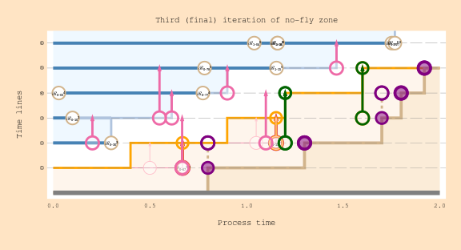

# Introduction

## Prelude

The package `EpidemicsCFTP` forms a crucial part of the code
for perfect simulation of epidemics conditioned on their removals.



## Brief description of `EpidemicsCFTP`  

Here follows a brief description of the module (under development):
```@docs
EpidemicsCFTP
```

Version information is as follows:
```@eval
import Markdown, EpidemicsCFTP
Markdown.parse("""
| _Software_             | _Version_                  | _Branch_                  | _Date of last commit_  |
|:-----------------------|:---------------------------|:--------------------------|:-----------------------|
| Running under `julia`  | `$VERSION`                 | ---                       |                        |
| Module `EpidemicsCFTP` | `$(EpidemicsCFTP.version)` | `$(EpidemicsCFTP.branch)` | $(EpidemicsCFTP.date)  |
""")
```

The aim of the module is to provide perfect simulation for a ``\operatorname{S-I-R}`` system obeying the Markov chain transition rates
```math
\begin{align*}
S \to S-1\,, \quad I \to I+1 \qquad & \text{ at rate } \alpha \; S I
\cr
I \to I-1\,, \quad R \to R+1 \qquad & \text{ at rate } \beta \; I
\end{align*}
```
and conditioned on all removal times.


## Installation and documentation  
General advice on developing a `julia` package is given at 
[`julialang.org/contribute/developing_package`](https://julialang.org/contribute/developing_package/).
Here is a basic summary. Working in `pkg` mode (using `]` at `julia` prompt):

1. Inform `pkg` that the package folder exists and is under development with `dev`.
(You may wish to do this within a particular `julia` environment.)
```julia
(v1.0) pkg> dev ~/.julia/dev/EpidemicsCFTP
```
2. Check that the package can be seen by `julia`.
```julia
(v1.0) pkg> status
```
3. Check that everything passes: by triggering performance of unit tests.
```julia
(v1.0) pkg> test EpidemicsCFTP
```

An alternative way to test the package is to run `make test` in the directory `EpidemicsCFTP`.
One should run `make doctest` to perform doctests.

Produce this documentation as follows: in directory `EpidemicsCFTP`, 

* run `make view` (for `gitbook` documentation)
* or `make view-pdf` (for `pdf` documentation).
