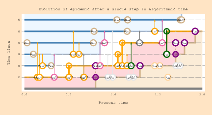

# Abstract


```@meta
CurrentModule = EpidemicsCFTP
DocTestSetup = quote
 using EpidemicsCFTP
end
```

The package 
[`EpidemicsCFTP`](https://github.com/WilfridSKendall/EpidemicsCFTP.jl)
provides 
[`julia`](https://julialang.org/) 
object types and methods
to perform perfect simulation of epidemics conditioned on observed (_active_) removals.


The aim is to provide 
Coupling from the Past
(_CFTP_) for a ``\operatorname{S-I-R}`` system
conditioned on all removal times and transitioning according to the following rates:

```math
\begin{align*}
S \to S-1\,, \quad I \to I+1 \qquad & \text{ at rate } \alpha \; S I \,,
\cr
I \to I-1\,, \quad R \to R+1 \qquad & \text{ at rate } \beta \; I    \,.
\end{align*}
```

The simulation mechanism uses "algorithmic time" to vary an event-based simulation
in a way that is reversible with respect to algorithmic time,
respects the conditioning on active removals,
and possesses sufficient monotonicity to permit construction of a classical 
CFTP algorithm.



