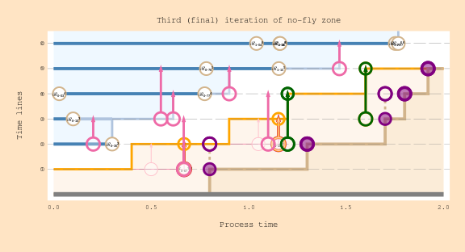

```@meta
CurrentModule = EpidemicsCFTP
DocTestSetup = quote
 using EpidemicsCFTP
end
```

# Introduction

## Prelude  

The package `EpidemicsCFTP` forms a crucial part of the code 
for perfect simulation of epidemics conditioned on their removals.


