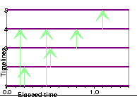
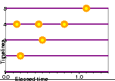
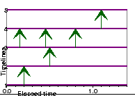
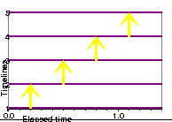
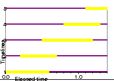
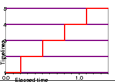
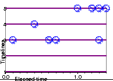
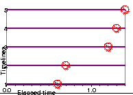
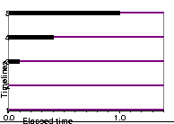
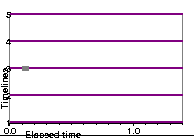

_____`pI-lo`: putative infection circumstances (thin pale green arrow, running from putative infecting row to row that would be infected).

For this infection actually to happen, the putative infecting row must be infected at the time of the
infection, and the row to be infected must be the lowest row susceptible at time of infection.

_____`lI`: locates latent infection (as a yellow circle with orange boundary on row that would be infected).

_____`lIc`: latent infection circumstances (thin dark green arrow, running from latent previously highest infected to new latent highest infected).

For this infection actually to happen, the putative infecting row must be infected at the time of the
infection, and the row to be infected must be the lowest row susceptible at time of infection.

_____`aI`: activated infection (thick yellow arrow, running from previously highest infected to new highest infected).

For this infection actually to happen, the putative infecting row must be infected at the time of the
infection, and the row to be infected must be the lowest row susceptible at time of infection.

_____`Infectious`: portions of rows that are infected (yellow lines).

_____`Epidemic`: traces most recently infected individual that is currently infected (as a thin red line).

_____`pR`: putative removal (blue no-way sign).

For this removal actually to take effect, the row on which it sits must be infected at the relevant time.
The lowest row currently infected will then suffer a removal.

_____`R`: implemented removal (red no-way sign).

This sits on the lowest row currently infected, which then suffers a removal;
it sits below the corresponding potential removal. Note that sometimes potential and
implemented removals coincide, in which case in the initial configuration of `static.py`
only the implemented removal is visible.

_____`Mordor`: to avoid premature removal, these black portions of rows should not be infected.

_____`nofly`: to avoid premature removal, these grey portions of rows should not be infected.
