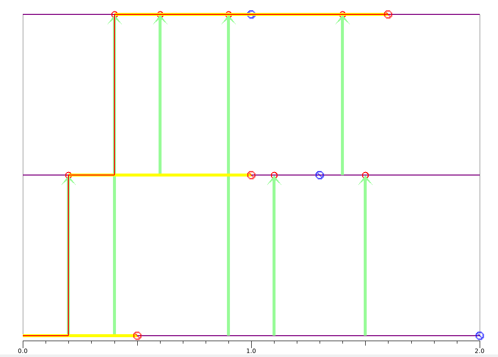

Prerequisites
=============
These programs are `python3` scripts, so `python3` is required. 

They also use the `Tkinter` and `Image` modules, while `Pandoc` is used to render documentation.
In `Ubuntu` use the following on the command-line:

    sudo apt-get install pandoc python3-tk python3-pil

I belive these are all that is required.
 
Testing FreeEpidemic
====================
Basic documentation
-------------------
Here are simple invocations of the `FreeEpidemic` and `Innovations` classes:

     >>> from pprint import pprint
     >>> from epidemic import Innovations, FreeEpidemic
     
     >>> iv = Innovations(remove=[[1, 1.6], [1.3], [0.5, 2]],
     ...                  infect=[[[0.2, 1.1, 1.5]],
     ...                          [[0.4, 0.9], [0.6, 1.4]]
     ...                         ])

Note the form of the `Innovations` structure:

     >>> print(iv)
     Innovations for SIR epidemic on 3 individuals:
     Row               List of proposed potential removals
       3:              0.50 2.00
       2:              1.30
       1:              1.00 1.60
     Target row
          (Origin)     List of proposed potential infections
       3:   (2)        0.60 1.40
            (1)        0.40 0.90
       2:   (1)        0.20 1.10 1.50

     >>> epidemic = FreeEpidemic(innovations=iv)
     >>> print(epidemic(pretty=True))  
     Time    S, I, R
     0.00   (2, 1, 0)
     0.20   (1, 2, 0)
     0.40   (0, 3, 0)
     0.50   (0, 2, 1)
     1.30   (0, 1, 2)
     2.00   (0, 0, 3)

Using `static.py`
-----------------
The program `static.py` produces a visual display of the epidemic.
Here is the invocation which produced the window shown in the screenshot:

	python3 static.py --title="Figure 1: an example of a Free SIR Epidemic" \
		--output=figure1a.png \
		--remove="[[1, 1.6], [1.3], [0.5, 2]]" \
		--infect="[[[0.2, 1.1, 1.5]], [[0.4, 0.9], [0.6, 1.4]]]"

Note the data format for the `remove` and `infect` lines. 
These define an `Innovations` instance, which is effectively
a list of two sub-lists. The first sub-list is the `remove`
list, containing `n` sub-sub-lists, one for each timeline row,
working from row `1` up to row `n` as per algorithm described
in the paper. Each such sub-sub-list is an ordered list of potential
removal times, the mark for each of these removals being implied by
the row corresponding to the sub-sub-list.

The second sub-list is the `infect` sub-list, containing `n-1`
sub-sub-lists. Each of these sub-sub-lists corresponds to a timeline
row starting at row `2` and working up to row `n`, and contains
sub-sub-sub-lists of potential infection times, one sub-sub-sub-list
corresponding to each row _below_ the timeline row corresponding to
the relevant sub-sub-list.

Other examples can be found in `Makefile`.
(You can access these simply using `make f1` or `f2` or `f3` or `f4`.)

Depress one of the buttons in the two rows at the bottom left of the window
in order to toggle disappearance (and then appearance) of the corresponding
elements in the image. This is useful for checking the image against the
commandline specification, as well as clarifying the elements of more complicated images.
Note that reinstated elements are placed at the top layer of the image; this means that
a double-click will make the relevant elements more prominent.

The colour coding in the screenshot is described in `static.cfg`:
