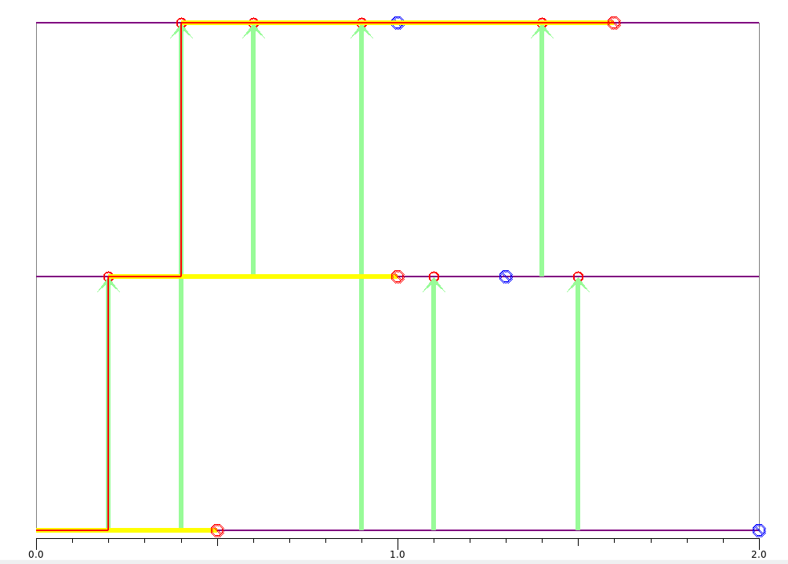
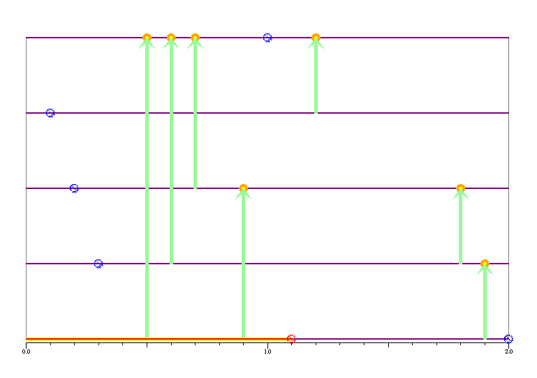
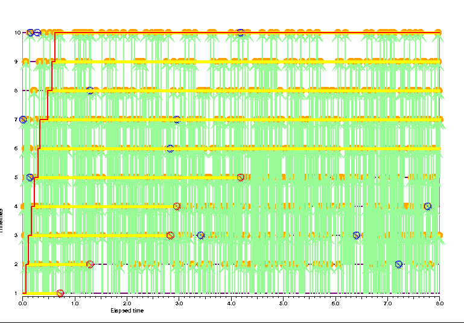

Testing FreeEpidemic
====================
Basic documentation
-------------------
Here are simple invocations of the `FreeEpidemic` and `Innovations` classes:

     >>> from pprint import pprint
     >>> from epidemic import Innovations, FreeEpidemic
     
     >>> iv = Innovations(remove=[[1, 1.6], [1.3], [0.5, 2]],
     ...                  infect=[[[0.2, 1.1, 1.5]],
     ...                          [[0.4, 0.9], [0.6, 1.4]]
     ...                         ])

Note the form of the `Innovations` structure:

     >>> print(iv)
     Innovations for SIR epidemic on 3 individuals:
     Row               List of proposed potential removals
       3:              0.50 2.00
       2:              1.30
       1:              1.00 1.60
     Target row
          (Origin)     List of proposed potential infections
       3:   (2)        0.60 1.40
            (1)        0.40 0.90
       2:   (1)        0.20 1.10 1.50

     >>> epidemic = FreeEpidemic(innovations=iv)
     >>> print(epidemic(pretty=True))  
     Time    S, I, R
     0.00   (2, 1, 0)
     0.20   (1, 2, 0)
     0.40   (0, 3, 0)
     0.50   (0, 2, 1)
     1.30   (0, 1, 2)
     2.00   (0, 0, 3)
     Infections at:
     [0, 0.2, 0.4]
     Removals at:
     [0.5, 1.3, 2]

Further examples
----------------
And now we present the results of three further tests.
     
     >>> rem = [[1.1, 2.0], [0.3], [0.2], [0.1], [1.0]]
     >>> ill = [[[1.9]], 
     ...        [[0.9], [1.8]],
     ...        [[], [], []], 
     ...        [[0.5], [0.6], [0.7], [1.2]]
     ...       ]
     >>> iv =Innovations(remove=rem, infect=ill)
     >>> epidemic = FreeEpidemic(innovations=iv)
     >>> print(iv)
     Innovations for SIR epidemic on 5 individuals:
     Row               List of proposed potential removals
       5:              1.00
       4:              0.10
       3:              0.20
       2:              0.30
       1:              1.10 2.00
     Target row
          (Origin)     List of proposed potential infections
       5:   (4)        1.20
            (3)        0.70
            (2)        0.60
            (1)        0.50
       4:   (3)        
            (2)        
            (1)        
       3:   (2)        1.80
            (1)        0.90
       2:   (1)        1.90

     >>> print(epidemic(pretty=True))   
     Time    S, I, R
     0.00   (4, 1, 0)
     1.10   (4, 0, 1)
     Infections at:
     [0]
     Removals at:
     [1.1]

     >>> rem = [[1.1, 2.0], [1.5], [1.3], [1.2], [1.0]]
     >>> ill = [[[0.1]], 
     ...        [[0.9], [1.8]],
     ...        [[], [1.25], []], 
     ...        [[0.5], [0.6], [0.7, 1.15], [1.2]]]
     >>> iv =Innovations(remove=rem, infect=ill)
     >>> epidemic = FreeEpidemic(innovations=iv)
     >>> print(iv)
     Innovations for SIR epidemic on 5 individuals:
     Row               List of proposed potential removals
       5:              1.00
       4:              1.20
       3:              1.30
       2:              1.50
       1:              1.10 2.00
     Target row
          (Origin)     List of proposed potential infections
       5:   (4)        1.20
            (3)        0.70 1.15
            (2)        0.60
            (1)        0.50
       4:   (3)        
            (2)        1.25
            (1)        
       3:   (2)        1.80
            (1)        0.90
       2:   (1)        0.10

     >>> print(epidemic(pretty=True))   
     Time    S, I, R
     0.00   (4, 1, 0)
     0.10   (3, 2, 0)
     0.90   (2, 3, 0)
     1.10   (2, 2, 1)
     1.25   (1, 3, 1)
     1.30   (1, 2, 2)
     Infections at:
     [0, 0.1, 0.9, 1.25]
     Removals at:
     [1.1, 1.3]

